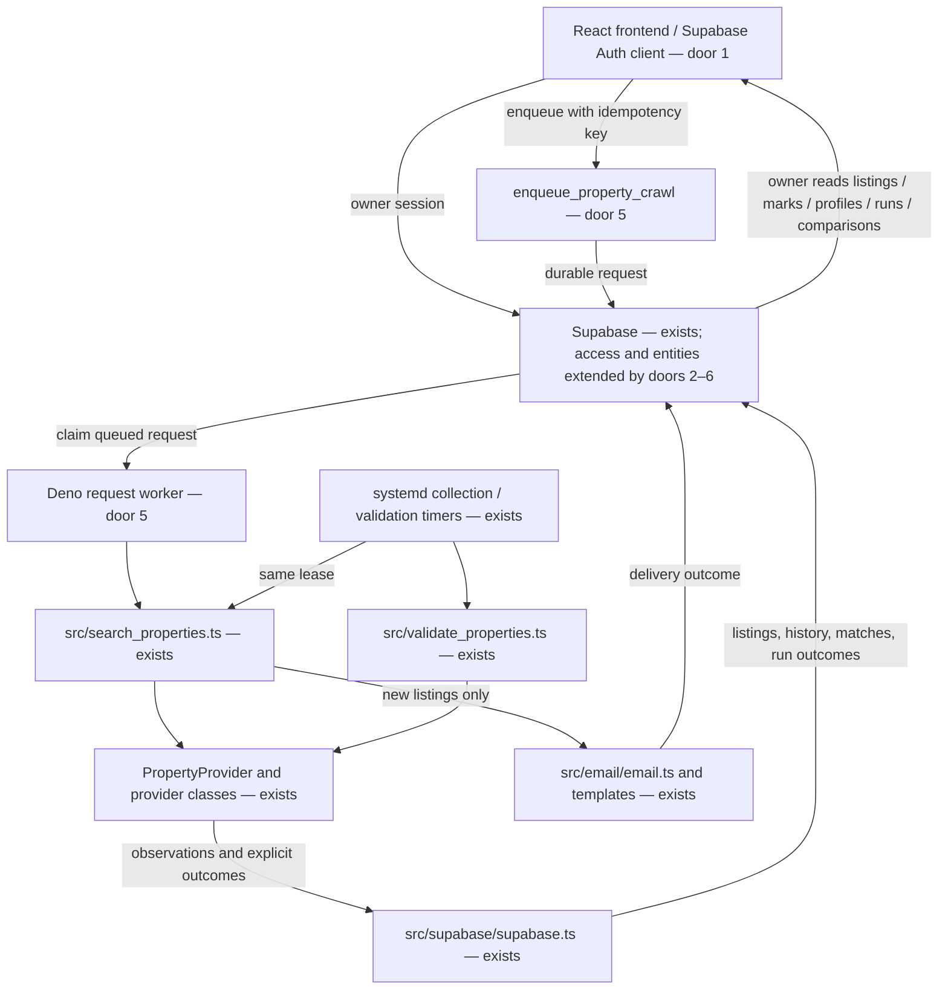

# House Crawler property interface

Status: approved for local checks/build by the user on 2026-11-17.

Verification profile: `light`, pinned on approval; the user did not select an upgrade. The reference repository is behavioral inspiration, not a pixel-exact design contract.

## Problem

The person searching for a property receives emails but must edit TypeScript to change searches, revisit portals to compare listings, and inspect terminal logs to understand collection failures. Saved listings contain only a title, display price, URL, and creation timestamp. Existing prices are never updated, and validation can delete listings after temporary access failures. There is no measured time-loss or conversion evidence.

When this ships, the owner can browse and shortlist properties, manage saved searches, observe and request collection, and inspect price changes from a private browser interface. Delivery follows the vertical slices below: browsing, shortlisting, collection management, then price intelligence. Each slice must be independently demonstrable; this is not a file-by-file task list.

## Flow

Reuse the existing Deno providers, Supabase persistence, Resend integration, and systemd schedules instead of creating a second crawler or scheduler.

The diagram shows asynchronous handoff: enqueueing acknowledges durable storage, not completion. Collection and validation both acquire the same database lease before contacting providers. The validator follows its existing schedule and does not gain a separate browser trigger. Email stays on the worker; closing the page does not interrupt collection.

## Impact

| Front | What changes |
| --- | --- |
| Domain | A listing remains a portal advertisement, identified by its existing canonical URL; two portals advertising one home remain two listings. |
| Domain | A saved search is an owner-managed set of the existing `SearchParams` plus enabled providers; a browse filter does not change what the crawler collects. |
| Domain | A run records collection or validation and distinguishes complete, partial, failed, and interrupted execution; zero matches is not a provider failure. |
| Existing data | Extend `real_states` additively. Preserve every existing URL, title, display price, and creation timestamp. New extracted attributes are nullable. Do not manufacture room, area, or address values from old search criteria. |
| Existing data | Parse unambiguous BRL values into integer centavos; retain the original string. Seed one initial price observation per parseable legacy listing using its original creation time, marked as a legacy import rather than an observed historical change. |
| Access | Replace permissive checked-in policies with owner-only access and trusted-worker writes. Migrate the worker credential and verify it before revoking anonymous writes. Live policies have not been inspected. |
| Collection | Update known listings and record changed prices instead of ignoring them. Replace boolean validation with active / removed / unknown outcomes; historical listings are not hard deleted. |
| Operations | Keep `deno task run`, `deno task validate`, and current systemd timer times. Add a long-running request worker on the same operator-controlled host; all entry points share a lease. No assumption that this host is a Mac. |
| Email | Preserve the existing new-listing email and environment-selected recipients. Store delivery outcome separately from collection outcome; never expose Resend credentials or arbitrary recipients to the browser. |
| Other plans | The existing flight-search documents remain intact. Their UI exclusion applies to that rollout; this proposal introduces a separate property-only interface. No flight tables, providers, or screens change. |

## Relations

| Entity | Relationship and constraint |
| --- | --- |
| Owner | One configured Supabase Auth identity owns all private property access for this release; no self-service enrollment (door 2). |
| Listing (`real_states`) | One listing has many price observations and zero or more search matches; its canonical URL retains its existing identity (doors 3–4). |
| ListingMark | An owner has at most one mark per listing; a mark combines one optional status and one optional note (door 3). |
| SearchProfile | The owner has many profiles; profiles and listings have a many-to-many match relation (door 4). Disabled profiles remain stored. |
| CrawlRequest | A request belongs to the owner, selects enabled profiles, and has at most one run; its idempotency identity is unique per owner (door 5). |
| Run | A run optionally belongs to a request, has many source outcomes and price observations, and carries an immutable snapshot of the profile configuration it used (doors 4–5). |
| WorkerLease | One lease serializes property collection and validation across browser requests, CLI commands, and timers; expiring ownership is fenced (door 5). |
| PriceObservation | Observations belong to a listing and optionally a run; retrying the same run/listing write cannot append a second observation (door 6). |

## Surface

The frontend uses Supabase's existing Auth and Data APIs; no bespoke HTTP application server is introduced. UI paths below return the SPA shell with HTTP 200; their application states are enumerated separately and must not be confused with HTTP status. Static hosting must support direct navigation to these paths.

| Route | In | Out | Status |
| --- | --- | --- | --- |
| `/login` | Email; Auth callback | Owner login/session or login error | 200; idle, sending, sent, error, unauthorized-account |
| `/` | Owner session | Counts, source summary, latest run, worker status | 200; loading, ready, empty, error, unauthorized |
| `/imoveis` | Query, sources, price/area/rooms/neighborhood, date, availability, mark, sort, page | Paginated listings | 200; loading, ready, empty, error, unauthorized |
| `/imoveis/:encodedLink` | Encoded canonical URL; owner session | Details, mark, price history, comparison | 200; loading, ready, not-found, error, unauthorized |
| `/buscas` | Profile edits; owner session | Persisted profiles or validation/save errors | 200; loading, ready, empty, invalid, saving, error, unauthorized |
| `/execucoes` | Owner session; selected run | Runs, source errors, request state | 200; loading, ready, empty, error, unauthorized |
| `POST /rest/v1/rpc/enqueue_property_crawl` (new) | Owner JWT; `request_key`, `profile_ids` | `{ request_id, outcome, retry_after_seconds }`; outcomes `accepted`, `replayed`, `busy`, `rate_limited` | 200; 400 invalid input or reused key with changed payload; 401 missing/invalid JWT; 403 non-owner |

Existing table API signatures are extended additively and access is restricted. New entities' Data API grants and policies follow door 2. UI errors show a Portuguese explanation and retry action; database/network diagnostics stay in sanitized operational records. Supabase Auth transport contracts are reused rather than redefined.

## Landing

| One-way door | Literal shape | Alternative rejected |
| --- | --- | --- |
| 1. Frontend precedent | `frontend/`: React + TypeScript + Vite, React Router, TanStack Query, Tailwind, existing `@supabase/supabase-js`; exact dependency versions and lockfile chosen from current documentation at build time. Pure domain types shared without importing Deno runtime modules into the browser. | Next.js server rendering adds a server lifecycle without a public SEO requirement; Fresh uses Preact and diverges from the accepted React reference. |
| 2. Private access model | Operator-configured owner Auth UUID; email magic-link login with account creation disabled. RLS/grants deny `anon`; authenticated owner reads listings/run status and owns marks/profiles; crawler-only tables and mutations require the server-side credential. Non-owner authenticated users have zero property access. Privileged RPCs validate owner identity in the database, with fixed search path and explicit EXECUTE grants. | Public policies expose collection data and writes; email-only client checks do not enforce authorization. Multi-user roles would expand this release's product scope. |
| 3. Listing identity and marks | Keep `real_states.link PRIMARY KEY`; mark key `PRIMARY KEY (user_id, listing_link)`; mark status is `favorite`, `contacted`, `discarded`, or null. Link changes are a new ad; no cross-portal identity merge. | New surrogate IDs plus URL remapping would require changing existing consumers; automatic home-level deduplication needs identity evidence this crawler lacks. |
| 4. Search storage and compatibility | `SearchProfile` stores the current `SearchParams` plus provider IDs `dfimoveis` / `wimoveis`. Persist profile-to-listing matches and immutable run configuration snapshots. Seed one default profile from the exact current entry-point configuration; legacy listings start with unknown profile match until observed. | Editing source from the UI is not a durable contract; assigning old listings to searches without observations invents provenance. |
| 5. Durable work and exclusion | RPC contract in Surface; `UNIQUE (owner_id, request_key)` with payload comparison; request states `queued -> running -> succeeded / partial / failed / interrupted`. At most one queued/running manual request globally. Shared property lease: 30-second renewal, 120-second expiry, monotonic fencing token checked by every run-data commit. An expired request is interrupted, never auto-replayed. New manual requests limited to one per owner per 60 seconds; idempotent replay bypasses that limit. | HTTP-bound scraping dies with request timeouts; in-memory locks do not serialize systemd, CLI, and the worker; unfenced expiry lets an old worker overwrite a new run. |
| 6. Lifecycle and history | Listing availability `active`, `removed`, `unknown`; preserve rows. Only confirmed HTTP 404/410 or explicit provider removal marks removed; missing from search results alone does not. Money uses nullable integer BRL centavos; observations `UNIQUE (run_id, listing_link)` for run-backed writes. | Deleting on a parse error or 403 destroys history; floating currency weakens exact comparisons; recording every identical observation makes retries look like market events. |
| 7. Comparison boundary | Comparable cohort: other active collected ads, same neighborhood and bedroom count, valid positive price and area; at least 5 peers, excluding the subject. Show median asking-price/m², peer count, and cohort label; no cohort means no score. | Block-level ranking needs address normalization and broader data; presenting collected-search medians as market valuation overstates coverage. |
| 8. Local proof harness | Disposable Supabase CLI project; pinned Playwright browser proofs and `postgres` wire-protocol test client; root Playwright config forwards to the frontend test configuration. | Mock-only database tests cannot establish RLS, concurrent locking, or HTTP error contracts. |

Nothing else in this change is hard to reverse. These decisions were approved with this plan; cross-feature constraints are recorded in the existing project decision log.

## Criteria

### S1: The owner can browse existing properties privately (P1)

This is the first complete release boundary: migrated legacy data is usable from a phone or desktop without changing the collection schedule.

**Acceptance Criteria**

1. WHEN the configured owner completes email magic-link authentication THEN the interface SHALL open the requested private route, defaulting to `/`.
2. WHEN an unauthenticated visitor opens a private route THEN the interface SHALL redirect to `/login` without displaying cached property data.
3. IF an authenticated non-owner calls a property Data API or enqueue RPC THEN the database SHALL deny access to all property records and mutations.
4. The deployed frontend bundle SHALL contain zero server-side Supabase credentials and zero Resend API keys.
5. WHEN the additive migration runs twice on the same legacy fixture THEN the database SHALL retain exactly the original listing identities and original `titulo`, `valor`, and `created_at` values.
6. WHEN a stored price is unambiguously parseable as BRL THEN the migration SHALL convert `R$ 1.234.567,89` to `123456789` centavos.
7. IF a stored price is absent, a range, or unparseable THEN the numeric price SHALL remain null.
8. WHEN the owner opens `/imoveis` THEN the interface SHALL show 30 results per page ordered by first-seen time descending with canonical URL ascending as the tie-breaker.
9. WHEN browse filters change THEN the listing query SHALL apply the conjunction of text, source, inclusive price/area bounds, exact room count, neighborhood, first-seen date, availability, and mark filters before pagination.
10. WHEN the owner chooses price order THEN numeric price SHALL determine ascending or descending ordering with unknown prices last and canonical URL ascending as the tie-breaker.
11. WHEN the owner reloads or shares a browse URL within their session THEN the interface SHALL restore its filters, order, and page from the URL query.
12. WHEN the owner opens a listing THEN the details screen SHALL display its title, source link, original price text, available structured attributes, and first/last observation timestamps, using `Não informado` for unknown attributes.
13. IF a listing photo is absent or fails to load THEN its card SHALL display a fixed-size placeholder without hiding the listing link.
14. WHEN the owner opens `/` THEN the dashboard SHALL show active listing count, listings first seen in the last 7 days, counts per source, and the latest persisted run outcome, using zero or `Sem execuções` when no data exists.
15. WHILE any private screen has its initial query pending THEN that screen SHALL display a labeled loading state instead of a zero-result state.
16. IF a list query succeeds with zero records THEN the corresponding dashboard, listings, searches, or runs screen SHALL show its named empty state with a next action.
17. IF a private screen query fails THEN that screen SHALL show a Portuguese error message and a retry control without claiming the result is empty.
18. IF a requested canonical URL has no saved listing THEN the detail screen SHALL show `Imóvel não encontrado` with a link back to `/imoveis`.
19. WHEN any screen is rendered at viewport widths 375px and 1440px THEN its page SHALL have no horizontal document overflow.
20. WHEN the owner navigates interactive controls using only a keyboard THEN each control SHALL expose an accessible name and visible focus indicator.

**Independent test:** Migrate a local legacy fixture; sign in as owner, signed-out visitor, and a second authenticated identity; exercise direct API denial, filtering, pagination, deep links, null data, and both viewport sizes. No property portal or production data is required.

### S2: The owner can maintain a shortlist (P1)

**Acceptance Criteria**

21. WHEN the owner saves a favorite, contacted, or discarded status THEN that listing's single owner mark SHALL persist the selected status after reload.
22. WHEN the owner saves a note of at most 2,000 characters THEN that listing's mark SHALL preserve the note as plain text after reload.
23. IF a note exceeds 2,000 characters THEN the save SHALL reject it without changing the persisted note.
24. IF saving a mark fails THEN the interface SHALL restore the last persisted mark and show a save error.
25. WHEN the owner clears a status THEN the mark SHALL preserve any existing note.
26. The mark controls SHALL treat discarded as a reversible status and SHALL expose no hard-delete listing action.

**Independent test:** Mark a fixture listing, write a note containing HTML, reload, filter by status, clear the status, and simulate a rejected write; verify persisted values and plain-text rendering.

### S3: The owner can manage searches and request collection (P2)

**Acceptance Criteria**

27. WHEN the owner creates or edits a saved search THEN `/buscas` SHALL persist its name, enabled state, providers, neighborhoods, room counts, suite count, area bounds, price bounds, elevator requirement, and parking requirement.
28. IF a profile has no supported provider/neighborhood/room, a name outside 1–80 characters, a non-integer room or suite count outside 0–10 (rooms minimum 1), negative/nonfinite bounds, or minimum above maximum THEN the database SHALL reject the entire profile write with no partial save.
29. WHEN profiles are initialized from the existing entry point THEN the default profile SHALL preserve its exact current search criteria and provider selection.
30. WHEN collection starts THEN the run SHALL persist an immutable snapshot of the enabled profile configuration it uses.
31. WHEN providers return candidate listings THEN persisted profile matches SHALL include only listings satisfying all required criteria using observed attributes; unknown required attributes do not satisfy the requirement.
32. WHEN the owner requests collection with a new request key and valid enabled profiles THEN the enqueue RPC SHALL return `accepted` only after a queued request is durable.
33. WHEN the same owner repeats a request key with the same profile selection THEN the enqueue RPC SHALL return the original request ID with `replayed` and create no second request.
34. IF a request key is reused with a different profile selection THEN the enqueue RPC SHALL return HTTP 400 without changing the original request.
35. IF another manual request is queued or running THEN a new enqueue call SHALL return `busy` with that request ID without creating another request.
36. IF a new enqueue call occurs less than 60 seconds after that owner's last accepted request and none is active THEN the RPC SHALL return `rate_limited` with a positive remaining retry interval without creating a request.
37. WHEN a healthy idle worker polls THEN it SHALL attempt to claim queued work at intervals no greater than 30 seconds.
38. WHEN scheduled collection, validation, and manual collection contend for the property lease THEN exactly one contender SHALL contact providers during the active lease.
39. IF a worker's lease has expired THEN any subsequent run-data write using its old fencing token SHALL be rejected.
40. IF an unfinished run's lease expires THEN the next healthy worker SHALL mark that run and its request `interrupted` before executing new work.
41. WHEN the worker is stopped or the browser is closed after enqueueing THEN a queued request SHALL remain stored until a worker claims it; browser closure does not cancel running work.
42. WHEN the owner opens `/execucoes` THEN the screen SHALL show runs newest first with source counts, start/end timestamps, per-source errors, and separate email delivery outcome.
43. WHEN heartbeat age exceeds 120 seconds THEN the dashboard SHALL show the worker as offline and display its last-seen timestamp; absent heartbeat shows `Nunca conectado`.
44. IF at least one source succeeds and at least one fails THEN the run SHALL finish `partial` while retaining listings collected from successful sources.
45. IF every source fails THEN the run SHALL finish `failed` without marking existing listings removed.
46. WHEN the existing CLI entry points finish THEN they SHALL exit 0 for complete runs, 1 for failed/partial runs, or 2 for lease contention, and print a summary containing the run ID and outcome.
47. IF the database is unreachable before lease acquisition THEN the worker or scheduled command SHALL make zero provider requests and report the database error.
48. WHEN a source request exceeds 30 seconds THEN the run SHALL record a timeout for that request; HTTP 429/5xx/network failures receive at most 2 retries with 2-second then 4-second delays, and 403 responses receive zero automatic retries.
49. WHEN run diagnostics are persisted THEN they SHALL contain run/source identifiers and error categories without credentials, Auth tokens, or raw environment-variable values.

**Independent test:** Use local Supabase, two competing worker processes, a fake clock, and deterministic provider/Resend fakes. Queue work, kill/restart a worker, attempt stale writes, change a profile mid-run, and simulate partial outages. Demonstrate that existing timer commands still acquire the same lease. Real-host provisioning is documented separately from this local demonstration.

### S4: The owner can inspect price changes and collected asking-price comparisons (P3)

**Acceptance Criteria**

50. WHEN either existing provider parses a listing fixture THEN its observation SHALL include source, canonical URL, price, area, rooms, neighborhood, optional photo, and optional elevator/parking/suite evidence, with null for absent attributes.
51. WHEN a known listing is observed at a changed numeric price THEN persistence SHALL update its current price and append exactly one run-linked price observation.
52. WHEN a known listing is observed at the same numeric price or the same run/listing write is retried THEN persistence SHALL append zero duplicate price observations.
53. IF an observation's price is unparseable THEN persistence SHALL preserve the last known numeric price and its observation timestamp rather than presenting the unknown observation as a price drop.
54. WHEN validation confirms a 404, 410, or explicit provider removal THEN the listing SHALL become removed while preserving its marks and price history.
55. IF validation encounters a 403, timeout, network failure, or missing parser fields THEN it SHALL record unknown verification without changing the listing's last confirmed availability.
56. WHEN a removed listing is observed active again THEN it SHALL return to active under the same canonical identity and retain its price history.
57. WHEN the owner opens listing details THEN the price-history view SHALL order observations by observation timestamp ascending and identify legacy-import observations separately.
58. WHEN a listing has at least 5 qualifying peers under door 7 THEN its comparison SHALL display their median asking-price/m², peer count, cohort label, and subject percentage difference, excluding the subject from the cohort.
59. IF fewer than 5 qualifying peers exist THEN the comparison SHALL show `Dados insuficientes` without a discount badge or rank value.
60. WHEN comparisons are displayed THEN the interface SHALL label them `Preços pedidos dos anúncios coletados` and display the comparison computation timestamp.
61. WHEN the owner sorts listings by opportunity THEN comparable listings SHALL be ordered by percentage below their cohort median descending, with unscored listings last and canonical URL ascending as the tie-breaker.
62. WHEN a collection saves new or updated listings THEN comparison values SHALL be recomputed from that committed dataset before the run is marked complete.
63. WHEN collection detects new listings THEN the existing email integration SHALL receive only those new listings using environment-configured recipients, with zero price-change-only emails.
64. IF email delivery fails after collection commits THEN the run SHALL retain collected listings and record delivery failure without rerunning collection or automatically resending the email.

**Independent test:** Replay fixtures at the same, lower, unknown, removed, and restored prices; inspect history and marks. Use cohorts with 4, 5, and 6 peers, including the subject and missing-field cases, to verify eligibility and median calculations. Stub Resend to distinguish collection from delivery outcomes.

## Out of scope

| Excluded | Why |
| --- | --- |
| Public listing portal, SEO pages, public registration, multiple roles | This release serves one owner; additional access models need a separate product decision. |
| Flights interface or flight-domain refactor | The existing flight initiative remains independent. |
| Maps, geocoding, block/quadra medians, market valuations | Current structured location and dataset breadth do not support reliable claims at that granularity. |
| Cross-portal home deduplication and AI ranking | URL identity is retained; resolving home identity needs additional evidence. |
| New portals, cloud anti-bot infrastructure, proxies | Preserve the two existing providers and use a host where access is verified. |
| Browser schedule editing, pause/cancel runs, automatic interrupted-run retry | Keep existing systemd scheduling and avoid ambiguous replay/cancellation semantics. |
| Email preview/editor, recipient management, price-drop email alerts | Preserve current email behavior while delivering the property interface; these can follow separately. |
| New notification channels, mobile apps, image mirroring | Responsive web and existing emails cover the accepted first workflow. |
| Automatic listing removal from disappearance in search results | Incomplete searches and narrowed profiles cannot establish removal. |

## Assumptions

| Assumption | Chosen default | Rationale | Confirmed? |
| --- | --- | --- | --- |
| Production topology | Static frontend hosting plus current Supabase project and existing operator-controlled crawler host | Matches the accepted separation; hosting choice remains reversible until deployment. | n |
| Visual direction | Portuguese UI, BRL and m², compact dashboard with responsive listing cards and optional dense table | Existing application output is Portuguese; the reference supplies workflow inspiration. | n |
| Diagnostics/history retention | No automatic purge in this release | Data volumes and retention needs have not been measured; keep monitoring history intact. | n |
| Verification preference | Use skill default `light` unless the user selects `standard` or `ui` before checks | No project profile declaration exists; stronger verification was recommended explicitly. | n |

**Open questions:** none blocking plan review. Owner identity, Auth redirect/domain configuration, hosted-frontend choice, live-schema inventory, and provider reachability are go-live inputs; they are not inferred from `.env` or needed to author local proofs.

## Observable

| Surface | Decision | Landing |
| --- | --- | --- |
| Login | Sending, success, errors, unauthorized account | AC 1–3; reuse Supabase Auth transport; unauthorized account receives no private data |
| Dashboard | Loading, empty, error, unauthorized | AC 2, 14–17 |
| Dashboard | Density, ordering, worker freshness | AC 14, 19–20, 43 |
| Listings | Loading, empty, error, unauthorized | AC 2, 15–17 |
| Listings | Density, filtering, ordering, unknown data, images | AC 8–13, 19–20, 61 |
| Listing detail | Loading, error, not-found, unauthorized | AC 2, 15, 17–18 |
| Listing detail | Ordering and history/comparison empty states | AC 12, 57–60 |
| Listings and details | Mutation, failure, destructive action | AC 21–26; n/a - no listing deletion; discard is reversible |
| Searches | Loading, empty, error, unauthorized | AC 2, 15–17 |
| Searches | Form bounds, save state, ordering, destructive action | AC 27–31; profiles ordered by name then identity; disable instead of delete |
| Runs | Loading, empty, error, unauthorized | AC 2, 15–17 |
| Runs | Density, ordering, per-source and email outcomes | AC 19–20, 42, 44–45, 64 |
| All screens | Keyboard operation, responsive layout | AC 19–20 |
| Enqueue RPC | Response/error shape and codes | Surface; AC 3, 32–36 |
| Enqueue RPC | Authorization, replay, concurrency, rate limit | Doors 2/5; AC 3, 33–40 |
| Data API | Access model and versioning | Door 2; AC 3–5; existing Supabase transport, additive schema under a jointly deployed frontend/worker |
| Worker/CLI/timers | Defaults and flags | Existing `run` and `validate` tasks retained; new `deno task worker` has no flags and uses environment configuration |
| Worker/CLI/timers | Output, exit status, partial failures | AC 42, 44–49, 64; Portuguese summaries plus sanitized structured run records |
| Collection organization | Grouping, duplicate identity, unknown source | Doors 3–4; AC 8, 29–31, 50; unknown legacy source displayed as `Fonte desconhecida` |
| Deployment runbook | Reader and next action | Operator runbook must describe owner provisioning, dry-run migration, worker credential cutover before policy restriction, smoke checks, frontend deep-link hosting, and disabling the new worker/UI without deleting retained data |
| New external webhook | Webhook behavior | n/a - no webhook is introduced |

The nine-dimension sweep is accounted for by criteria: validation/bounds (7, 23, 28), partial failure (24, 44–48, 64), replay/duplicates (33–36, 51–52), authorization/rate limits (2–4, 36), concurrency/ordering (8, 30, 38–40), lifecycle (5, 54–57), external failures (43–48, 55), transitions (32, 40, 54–56), observability (14, 42–43, 49). The next phase derives the authoritative `Swept` check references rather than copying this map as evidence.

## Sources

- User conversation, 2026-11-17: accepted React + Vite + Supabase with a separate Deno worker and requested a tlc-spec-lean execution plan; settles the architecture direction and delivery order.
- [Radar Imóveis DF](https://github.com/brunovsiqueira/radar-imoveis-df/blob/main/README.md): behavioral inspiration for browsing, profiles, request-driven collection, run visibility, and comparisons; not an exact layout or a requirement to port Python/SQLite.
- Repository behavior in `src/types.ts`, `src/search_properties.ts`, `src/validate_properties.ts`, `src/supabase/`, and `scripts/*.timer`: establishes compatibility and data-migration obligations; existing `.specs/project/STATE.md` AD-001–003 remain applicable within their flight scope.
