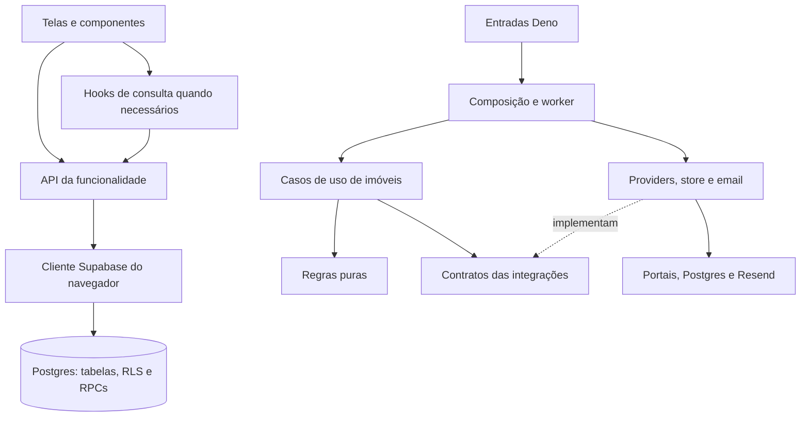

# Proposta de arquitetura orientada à leitura

Status: executada. Consulte [a arquitetura atual](architecture.md) e [o mapa do banco](database.md). O diagnóstico abaixo registra a estrutura anterior à reorganização.
Base: código presente no workspace em 18/11/2026, incluindo alterações locais.

## 1. Direção recomendada

Manter uma aplicação modular no mesmo repositório, com dois executáveis: a
interface React e o coletor Deno. Organizar a interface por funcionalidade e
separar, dentro do módulo de imóveis, regras de negócio, fluxos de execução e
integrações externas.

O código do backend ficará em `backend/src/`. A pasta `supabase/` da raiz
passará para `backend/supabase/`, reunindo configuração e migrations do banco
com o backend.
A interface permanece em `frontend/src/`, e os contratos compartilhados ficam
em `shared/`, fora dos dois executáveis.

O objetivo é conseguir responder pelo caminho e pelo nome de um arquivo:
**o que ele faz, quem o chama e quais efeitos ele pode produzir?**

Deno, React, Supabase, Resend e o modelo atual de implantação continuam adequados
à reorganização proposta. Ela não exige microserviços, outro framework, um
servidor HTTP intermediário ou um contêiner de injeção de dependências.

## 2. Diagnóstico do código atual

| Arquivo                                              | Situação observada                                                                                | Consequência para a leitura                                                               |
| ---------------------------------------------------- | ------------------------------------------------------------------------------------------------- | ----------------------------------------------------------------------------------------- |
| `frontend/src/pages.tsx` — 739 linhas                | Dashboard, listagem, detalhe, buscas, execuções, formulários e consultas Supabase                 | Para entender uma tela, é necessário navegar por várias funcionalidades                   |
| `frontend/src/App.tsx` — 280 linhas                  | Sessão, autorização, login, layout, rotas, componentes de estado e solicitação de coleta          | O ponto de entrada esconde os limites entre navegação e funcionalidades                   |
| `frontend/src/api.ts` — 121 linhas                   | Criação do cliente, tratamento de respostas, formatação e consultas de funcionalidades diferentes | O nome não informa onde procurar cada comportamento; outras consultas continuam nas telas |
| `src/property/runner.ts` — 269 linhas                | Contratos, coleta, validação, renovação de lease, email, diagnósticos, códigos de saída e polling | Alterações em fluxos distintos acabam no mesmo arquivo                                    |
| `src/types.ts` — 176 linhas                          | Classe abstrata com HTTP, parsing, espera, coleta e verificação, além de tipos                    | Um arquivo chamado `types` executa boa parte do scraping                                  |
| `src/property/model.ts` — 67 linhas                  | Tipos compartilhados, conversão monetária, parsing de preço e correspondência com buscas          | O frontend importa um caminho interno do backend                                          |
| `src/supabase/supabase.ts` e `src/property/store.ts` | Cliente e funções antigas de persistência convivem com a persistência atual via RPC               | Há caminhos concorrentes para entender como imóveis são gravados                          |
| `supabase/migrations/*`                              | Tabelas, autorização e funções transacionais com muitos comandos comprimidos em uma linha         | Regras essenciais são difíceis de revisar                                                 |

O tamanho não é o único critério: `http.ts` já tem uma responsabilidade clara,
assim como a separação entre envio de email e seu template. Esses limites devem
ser aproveitados.

Há também dependências que tornam a navegação circular:

- `App.tsx` importa `pages.tsx`, que importa componentes de `App.tsx`.
- Os providers usam `types.ts`, que importa diagnósticos de `runner.ts`.
- `parsing.ts` usa utilitários da pasta de providers, embora seja usado por eles.

O `deno.json` já define dois espaços de indentação e largura de 80 caracteres.
Isso resolve parte da aparência, mas não separa responsabilidades nem melhora
automaticamente nomes como `q`, `d`, `p` e `r` em fluxos longos.

O README ainda descreve um `main.ts` ausente da árvore atual. Os documentos em
`.specs/codebase/` também contêm descrições anteriores à interface e ao worker
atuais. A documentação precisa acompanhar a estrutura real.

## 3. Estrutura sugerida

Os nomes abaixo representam responsabilidades concretas. Criar as pastas ao
mover o código correspondente, sem adicionar módulos vazios.

```text
shared/                              # Código puro consumido por Deno e React
  property.ts                        # Property, Listing, SearchParams, Profile
  money.ts                           # Conversão para centavos
  database.types.ts                  # Tipos gerados; sem edição manual

backend/
  supabase/
    config.toml                      # Configuração do Supabase local
    migrations/                      # Histórico versionado do banco
  src/
    search_properties.ts               # Entrada compatível: chama main('collect')
    validate_properties.ts             # Entrada compatível: chama main('validate')
    worker.ts                          # Entrada compatível: chama main('worker')

    runtime/
      main.ts                          # Escolhe comando e apresenta resultado
      config.ts                        # Lê e valida configuração do ambiente
      dependencies.ts                  # Constrói store, providers e notificações
      poll-worker.ts                   # Heartbeat, agendamento e consumo da fila

    property/
      domain/
        matches-profile.ts             # Regras de correspondência de uma busca
      application/
        execute-run.ts                 # Claim, lease, despacho e finalização
        collect-properties.ts          # Coleta por perfil/fonte e deduplicação
        validate-properties.ts         # Verifica anúncios já armazenados
        notify-new-properties.ts       # Seleciona novidades e coordena o envio
      ports.ts                         # Contratos de store/provider/notificação
      providers/
        base-property-provider.ts      # Comportamento de scraping compartilhado
        df-imoveis.ts                   # URLs e extração específicas do portal
        wimoveis.ts
        parse-property-html.ts         # Extração de atributos a partir do HTML
        html-utils.ts                  # Normalização de texto e URLs
        registry.ts                    # Resolve identificador/domínio → provider
      persistence/
        supabase-property-store.ts     # Implementa o contrato usando tabelas/RPCs
      notifications/
        send-property-email.ts         # Integração com Resend
        property-email-template.ts     # HTML e texto do email

    platform/
      http-client.ts                   # Timeout, cancelamento e retry
      diagnostics.ts                   # Categorias de erro sanitizadas
      supabase-client.ts               # Cliente com credencial do worker
      robots.ts                        # Utilitário existente de robots.txt

frontend/src/
  app/
    App.tsx                          # Composição da aplicação
    routes.tsx                       # Mapa de rotas
    AppLayout.tsx                    # Navegação, cabeçalho e rodapé
  features/
    auth/
      LoginPage.tsx
      RequireOwner.tsx               # Guarda das rotas privadas
      useSession.ts
      auth.api.ts
    dashboard/
      DashboardPage.tsx
      dashboard.api.ts
    listings/
      ListingsPage.tsx
      ListingDetailPage.tsx
      ListingFilters.tsx
      ListingCard.tsx
      PropertyPhoto.tsx
      PropertyMarkForm.tsx
      listings.api.ts
      listings.queries.ts            # Hooks/chaves de consultas e mutations
      listing-filters.ts             # Tradução entre filtros e URL
    searches/
      SearchesPage.tsx
      SearchProfileForm.tsx
      searches.api.ts
    runs/
      RunsPage.tsx
      CollectButton.tsx
      runs.api.ts
  components/
    PageHeading.tsx
    LoadingState.tsx
    ErrorState.tsx
    EmptyState.tsx
  lib/
    supabase.ts                      # Cliente com chave pública e sessão
    query-result.ts                  # Tratamento comum de respostas
    formatters.ts                    # Preço, data e nomes das fontes
  styles/
    tokens.css
    global.css
  main.tsx

tests/
  unit/                              # Regras puras, parsing e aplicação com fakes
  integration/                       # Banco, RPCs e processos CLI locais
  support/                           # Fakes e preparação compartilhados
  fixtures/                          # HTML e outros dados de teste
frontend/tests/                      # Fluxos completos no navegador
docs/
  architecture.md                    # Mapa da arquitetura após a migração
  database.md                        # Tabelas, RPCs e regras transacionais
  property-interface.md              # Operação e implantação
scripts/                             # Supervisão e execução no host
```

Manter estilos específicos perto da funcionalidade que os usa, por exemplo
`features/listings/listings.css`. Separar o CSS atual conforme esses limites;
quantidade de linhas, isoladamente, não justifica a divisão.

`shared/` recebe somente contratos e funções puras realmente usados pelos dois
executáveis. Não deve importar React, Deno, clientes de banco ou variáveis de
ambiente. Tipos de linha do banco e modelos de aplicação continuam distinguíveis:
o primeiro descreve a persistência; o segundo descreve o dado usado no fluxo.

## 4. Regras de dependência



- Telas cuidam da apresentação e dos eventos de interface. Consultas e gravações
  ficam em `*.api.ts`; coordenação de cache e mutations pode ficar em hooks.
  Uma consulta simples não precisa ganhar um hook próprio apenas por convenção.
- Componentes compartilhados não importam `App.tsx` nem telas de funcionalidades.
- Casos de uso conhecem contratos e regras puras; não importam Resend, Cheerio,
  Supabase ou classes concretas dos portais.
- Integrações implementam os contratos. O contrato não fica no arquivo do
  orquestrador que o consome, e providers não importam esse orquestrador.
- `dependencies.ts` conecta as implementações usando objetos e funções, seguindo
  a injeção que já existe em `Dependencies`.
- Usar imports diretos durante a reorganização. Um `index.ts` em cada pasta
  adicionaria outro salto para descobrir onde o código realmente está.

### Limite entre aplicação e banco

O worker atual depende de regras transacionais implementadas em SQL: fila,
idempotência, exclusão mútua, token de lease e autorização. Essas regras permanecem
no banco. Mover arquivos TypeScript não é motivo para reimplementá-las em memória.

`execute-run.ts` coordena a execução: adquire o trabalho, inicia a renovação,
chama coleta ou validação, coordena notificação e finaliza. Os fluxos extraídos
recebem o contexto da execução e o sinal de cancelamento. A renovação deve ser
encerrada em `finally`, mantendo a proteção contra escritas com token vencido.

A interface continua acessando o Supabase com sessão do usuário e as políticas
existentes. A credencial administrativa continua exclusiva do worker.

As migrations já versionadas permanecem como histórico. Para facilitar a leitura,
documentar em `docs/database.md` as funções, tabelas e invariantes, com referências
às migrations. Adotar SQL expandido nas próximas migrations; mudanças de definição
de funções seguem novas migrations, sem reescrever o histórico aplicado.

## 5. Legibilidade dentro dos arquivos

Adotar convenções simples, além da formatação automática:

- Dois espaços, largura de 80 caracteres e aspas simples, preservando a
  configuração atual do Deno. Incluir TSX nas verificações de formatação e adotar
  um formatador SQL compatível com PL/pgSQL para novos arquivos.
- Uma declaração de estado por linha. Separar imports, tipos, constantes,
  funções e blocos de processamento com linhas em branco.
- Nomes que expliquem o papel: `listingsQuery`, `listing`, `searchProfile`,
  `runResult`. Reservar nomes curtos para contextos pequenos e evidentes.
- Preferir retornos antecipados para carregamento, erro e vazio a sequências
  longas de ternários aninhados no JSX.
- Extrair componentes com significado próprio, como filtros e formulário de
  busca. Um trecho de três linhas não precisa virar outro arquivo.
- Usar tipos explícitos para estados e resultados fechados. Por exemplo,
  `RunKind = 'collect' | 'validate'` e um tipo separado para o comando `'worker'`;
  o worker consome trabalhos, não representa uma terceira espécie de coleta.
- Comentários explicam decisões e invariantes, como a proteção do lease ou o
  arredondamento monetário, em vez de apenas repetir o nome da função.

Exemplo do estilo desejado para uma tela, apenas ilustrativo:

```tsx
export function ListingsPage() {
  const filters = useListingFilters();
  const listingsQuery = useListings(filters);

  if (listingsQuery.isPending) {
    return <LoadingState />;
  }

  if (listingsQuery.isError) {
    return <ErrorState retry={() => void listingsQuery.refetch()} />;
  }

  return <ListingsView listings={listingsQuery.data} filters={filters} />;
}
```

## 6. Mapa dos arquivos atuais

Os caminhos de origem abaixo descrevem a estrutura atual. Todos os destinos de
código do backend são relativos a `backend/src/`; `shared/` e `frontend/`
continuam na raiz. A configuração e as migrations usam `backend/supabase/`.

| Origem                           | Destino / ação                                                                                                  |
| -------------------------------- | --------------------------------------------------------------------------------------------------------------- |
| `frontend/src/pages.tsx`         | Distribuir entre `features/dashboard`, `listings`, `searches` e `runs`                                          |
| `frontend/src/App.tsx`           | Separar composição, rotas, layout, auth, estados compartilhados e botão de coleta                               |
| `frontend/src/api.ts`            | Separar cliente, formatadores e APIs de cada funcionalidade                                                     |
| `src/types.ts`                   | Mover `PropertyProvider` para `base-property-provider.ts`; importar tipos de `shared/property.ts`               |
| `src/property/model.ts`          | Separar contratos compartilhados, dinheiro e regras de correspondência; parsing de preço fica junto da extração |
| `src/property/runner.ts`         | Extrair contratos, diagnósticos, polling e fluxos; manter um coordenador de execução pequeno                    |
| `src/property/cli.ts`            | Dividir entre `runtime/main.ts`, configuração e composição de dependências                                      |
| `src/property/store.ts`          | Mover para `property/persistence/supabase-property-store.ts`                                                    |
| `src/property/http.ts`           | Mover para `platform/http-client.ts` sem alterar retry e cancelamento                                           |
| `src/property/parsing.ts`        | Mover para `property/providers/parse-property-html.ts`                                                          |
| `src/providers/*`                | Mover para `property/providers/`; nomear utilitários pelo assunto                                               |
| `src/email/*`                    | Mover para `property/notifications/`, preservando envio separado do template                                    |
| `src/supabase/supabase.ts`       | Extrair cliente; verificar consumidores antes de remover funções antigas                                        |
| `src/supabase/database.types.ts` | Mover para `shared/database.types.ts`; documentar regeneração                                                   |

A pasta atual `supabase/` será movida integralmente para `backend/supabase/`,
preservando `config.toml`, nomes das migrations e histórico. Os comandos do
Supabase deverão ser executados a partir de `backend/`, ou com o diretório de
trabalho equivalente explicitamente configurado.

Na busca por referências em `src`, `tests` e `frontend/src`, as funções
`insertNewProperties`, `getAllProperties` e `deleteProperties` aparecem somente em
suas próprias definições. São candidatas a remoção após verificar scripts,
documentação e outros consumidores. Não criar uma segunda persistência nova para
preservar funções sem uso.

## 7. Migração gradual e verificação

1. **Estabelecer a referência atual.** Registrar os resultados de lint, build e
   testes existentes, distinguindo falhas anteriores. Identificar quais provas
   precisam do Supabase local. Preservar as alterações já presentes no workspace.
2. **Desagrupar o frontend.** Primeiro extrair os estados compartilhados para
   eliminar o ciclo entre `App` e `pages`. Depois mover uma tela por vez e suas
   consultas. Preservar URLs, query keys, filtros e aparência. Validar build e
   fluxos existentes de login, listagem, notas, buscas e solicitação de coleta.
3. **Explicitar os contratos do backend.** Extrair tipos puros, contratos e
   diagnósticos; mover o código de `src/` para `backend/src/`, incluindo a classe de
   provider e o cliente, e `supabase/` para `backend/supabase/`. Atualizar os caminhos
   do Supabase usados pelos testes e comandos locais, imports, tarefas do
   `deno.json`, scripts de
   operação e configurações TypeScript/Vite que dependam dos novos caminhos. Validar também
   os processos CLI de teste, incluindo suas substituições de HTTP e email.
4. **Separar os fluxos.** Extrair coleta, validação e polling sem mudar seus
   resultados. Preservar renovação/cancelamento, deduplicação, resultados parciais,
   agendamento idempotente e comportamento quando o email falha. Usar as provas
   existentes de worker, banco e agendamento como referência de equivalência.
5. **Consolidar leitura e documentação.** Remover código sem consumidores,
   reorganizar testes por assunto e separar CSS por funcionalidade. Atualizar os
   caminhos de descoberta de testes e fixtures; testes de banco e navegador que
   compartilham dados locais continuam sequenciais. Atualizar o README e marcar
   mapas antigos como históricos ou substituí-los por referências ao mapa atual.

Fazer movimentos mecânicos e mudanças de comportamento em alterações separadas.
As entradas passam de `src/search_properties.ts`, `src/validate_properties.ts` e
`src/worker.ts` para `backend/src/search_properties.ts`,
`backend/src/validate_properties.ts` e `backend/src/worker.ts`. Continuam como wrappers;
as tarefas Deno mantêm seus nomes públicos e passam a apontar para `backend/src/`.
O `deno.json` e o lockfile Deno permanecem na raiz nesta proposta.
Atualizar os scripts que referenciem os caminhos antigos na mesma etapa, sem
manter uma segunda árvore permanente em `src/`.

Critério de conclusão: localizar uma tela sem abrir outras telas; acompanhar
uma coleta sem ler o fluxo de validação; identificar consultas e efeitos externos
pelo nome e caminho; executar as mesmas provas com resultados equivalentes.

## 8. Limites da proposta

Há planejamento local para buscas de voos em `.specs/`. Quando essa funcionalidade
for implementada, poderá ocupar `backend/src/flight/` com modelos e providers próprios.
Não compartilhar a classe de scraping de imóveis nem criar agora um motor genérico
de oportunidades. Compartilhar HTTP ou envio de mensagens somente quando houver
uso concreto e requisitos compatíveis.

Esta proposta reorganiza o código existente. Mudanças de produto, correções de
comportamento, aplicação de migrations e implantação exigem trabalho separado.
