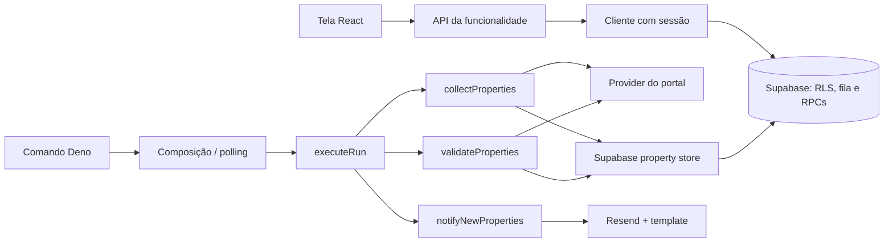

# Arquitetura

A aplicação tem dois executáveis: a interface React e o coletor Deno.
O Supabase guarda o estado durável e protege o acesso. Os portais e o Resend
são integrações do worker.

## Por onde começar

| Quero entender ou alterar         | Arquivo / pasta                                               |
| --------------------------------- | ------------------------------------------------------------- |
| Quais telas existem               | `frontend/src/app/routes.tsx`                                 |
| Navegação e cabeçalho             | `frontend/src/app/AppLayout.tsx`                              |
| Sessão e autorização              | `frontend/src/features/auth/`                                 |
| Filtros e cards                   | `frontend/src/features/listings/`                             |
| Buscas salvas                     | `frontend/src/features/searches/`                             |
| Fila e histórico na interface     | `frontend/src/features/runs/`                                 |
| Inicialização dos comandos        | `backend/src/runtime/main.ts`                                 |
| Integrações concretas             | `backend/src/runtime/dependencies.ts`                         |
| Ciclo completo de execução        | `backend/src/property/application/execute-run.ts`             |
| Regras de correspondência         | `backend/src/property/domain/matches-profile.ts`              |
| Scraping e atributos do anúncio   | `backend/src/property/providers/`                             |
| Contrato de persistência          | `backend/src/property/ports.ts`                               |
| Tabelas e RPCs usados pelo worker | `backend/src/property/persistence/supabase-property-store.ts` |
| Banco e invariantes               | [database.md](database.md)                                    |

## Fluxo de uma coleta

1. Uma tarefa Deno ou o polling solicita trabalho ao store.
2. O banco adquire o lease e devolve uma fotografia dos perfis de busca.
3. `executeRun` mantém a renovação do lease e o sinal de cancelamento.
4. `collectProperties` percorre perfis/fontes, grava observações e registra
   resultados por fonte. Reúne identidades novas sem duplicar a notificação.
5. `notifyNewProperties` envia somente novidades que correspondem aos perfis.
6. O coordenador finaliza a execução com estado da coleta e do email separados.
   A renovação é encerrada em `finally`.

A validação usa o mesmo coordenador, mas chama `validateProperties` para verificar
os imóveis já persistidos. O polling publica heartbeat, tenta enfileirar a coleta
agendada e processa solicitações. Falha de agendamento não impede a fila manual.

## Limites dos módulos

- `shared/` é puro e não importa Deno, React ou clientes externos.
- Telas e formulários chamam `*.api.ts`; consultas Supabase não ficam no JSX.
  Hooks de consulta coordenam chaves de cache quando necessário.
- Casos de uso dependem de contratos e regras puras. Os adapters implementam
  esses contratos. A composição conecta objetos e funções, sem framework extra.
- Os providers não importam o coordenador de execução. HTTP e diagnósticos
  ficam em `platform/`; parsing de HTML permanece no contexto de imóveis.
- Cliente do navegador usa chave pública e sessão; cliente do worker usa chave
  administrativa do ambiente. O frontend não importa código do backend.
- Regras transacionais de fila e lease continuam no Postgres. Não duplicar essas
  regras em memória nem criar outra forma de gravar imóveis fora do store.

## Convenções de leitura

Dois espaços, aspas simples e largura de 80 caracteres. Separar imports,
declarações e funções com linhas em branco. Usar uma declaração de estado por
linha e nomes que indiquem seu papel. Extrair componentes e funções por
responsabilidade, sem criar arquivos para cada expressão curta.

`deno task fmt:check` verifica código Deno, React, CSS e testes com a mesma
configuração. Tipos gerados não recebem edição manual. Futuras migrations usam
SQL expandido e indentado; as migrations existentes mantêm seus bytes originais.

## Testes

`tests/unit/` executa regras, HTTP, parsing e aplicação com fakes sem banco.
`tests/integration/` verifica o banco, os adapters e os processos CLI locais.
`tests/support/` contém preparação, fakes e subprocessos; `tests/fixtures/`
contém HTML dos portais. `frontend/tests/` cobre os fluxos reais no navegador.
As assertions existentes foram mantidas durante a reorganização.

Os executáveis Deno e a configuração Supabase ficam dentro de `backend/`.
Configuração Deno, ambiente do worker e tarefas públicas continuam na raiz.
Comandos Supabase usam `--workdir backend`; isso não altera o identificador do
projeto local nem seus dados.

A [proposta original](architecture-proposal.md) registra o diagnóstico e o plano
aprovado. Mapas anteriores em `.specs/` descrevem o estado da época e não
substituem este documento.
